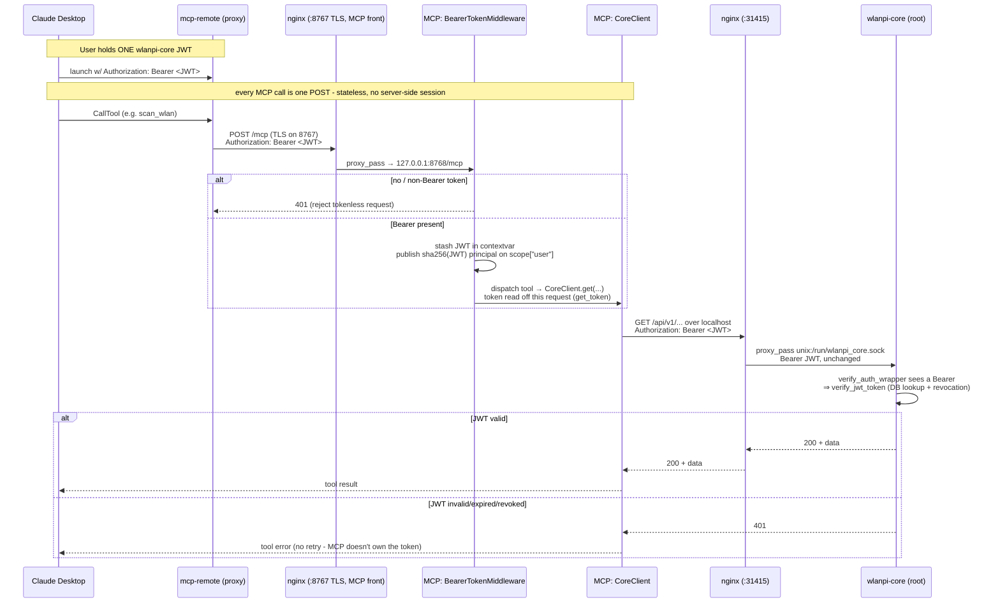
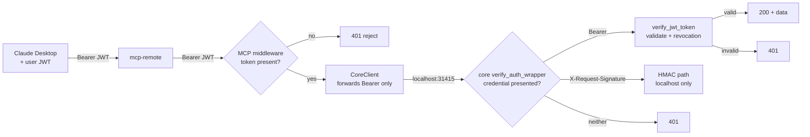

# Authentication flow: Claude → MCP → nginx → wlanpi-core

wlanpi-mcp implements **no authentication of its own**. The user holds a single
wlanpi-core JWT, and that same token is forwarded on every outbound wlanpi-core API call,
where core validates it. This document traces the token end to end.

The MCP endpoint (`/mcp`, streamable HTTP, stateless) is fronted by an MCP-owned
nginx site: the uvicorn daemon binds loopback-only (127.0.0.1:8768) and nginx
exposes it on `8767`, terminating the device's self-signed TLS. That is the
only MCP endpoint: the plaintext `8766` fallback was removed (#17), so the JWT
never crosses the LAN in cleartext.

## Sequence

## Where each auth decision happens

## The key handoffs, in words

| Hop | Carries | Auth decision |
|---|---|---|
| Claude Desktop → mcp-remote | `Authorization: Bearer <JWT>` | none - just transport |
| mcp-remote → MCP nginx front (`:8767` TLS) | the same Bearer on every `/mcp` POST | **nginx:** TLS termination with the self-signed cert; the JWT is encrypted in transit |
| MCP nginx front → MCP middleware | same Bearer, forwarded to `127.0.0.1:8768` | **MCP:** reject if no Bearer (401); else stash JWT in contextvar |
| MCP CoreClient → core nginx | `Bearer <JWT>` | none yet - MCP never validates |
| core nginx → core (unix socket) | the same Bearer, proxied unchanged | none - nginx only proxies |
| core `verify_auth_wrapper` | sees a Bearer | **core:** takes JWT branch → validates token, checks revocation |

The single source of truth for "is this caller allowed" stays in core's `verify_jwt_token` -
MCP and nginx only route; neither mints nor validates tokens. The one JWT the user holds
is the same credential end to end.

## How core picks the auth scheme

Core chooses the scheme from the credentials presented (wlanpi-core#159): a Bearer goes to
JWT validation, an `X-Request-Signature` goes to HMAC (localhost only), and neither is a
401. Source IP no longer matters for a Bearer, so the MCP service needs no special header
and never touches the root-owned HMAC secret.

## One token per request: the stateless transport

The daemon serves streamable HTTP in stateless mode (`stateless_http=True` in
`create_http_app`). There is no server-side MCP session: every `POST /mcp` is a complete
exchange, handled by a server instance created for that request and torn down after it.
Two consequences:

- **The token that reaches wlanpi-core is the Bearer on that very request.**
  The middleware sets a contextvar from that request's `Authorization` header, and
  `get_token()` (`wlanpi_mcp/auth/token_context.py`) reads only that contextvar. mcp 2.x
  runs each handler in the context of the request that carried the call, so concurrent
  requests with different tokens stay isolated.
- **There is no session for another caller to inject into.** Under the legacy SSE
  transport a session spanned a long-lived `GET /sse` plus per-call `POST /messages/`
  requests routed by `session_id`, and the server had to bind each session to the token
  that opened it. With nothing shared between requests, that attack surface is gone.

`BearerTokenMiddleware` still publishes a principal on `scope["user"]` keyed by
`sha256(token)`. The SDK's streamable HTTP session manager binds sessions to that
principal and refuses a mismatched request with the same `404` as a nonexistent session,
so the per-token binding is in place should stateful mode ever be enabled. The token is
not parsed or validated here (that stays wlanpi-core's job); the fingerprint only needs to
be stable and unique per token, so a raw SHA-256 suffices and keeps the token itself off
the principal object.

Why stateless: the legacy SSE transport stranded Claude Code after any reconnect (daemon
restart, idle gap). The client re-opened the stream without re-sending `initialize`, and
the server answered every later tool call with `-32602 Invalid request parameters`
(python-sdk issue #2579, closed as not planned). A stateless server has no handshake
state to lose. Transport
encryption is a separate control and is provided by the MCP nginx front:
nginx terminates TLS on 8767 (self-signed cert) in front of the loopback-only
daemon, so the token never crosses the wire in cleartext.

## Stdio mode

There are no HTTP headers in stdio transport, so the middleware/contextvar path does not
apply. `WLANPI_CORE_TOKEN` from config/env is the fallback token source.
